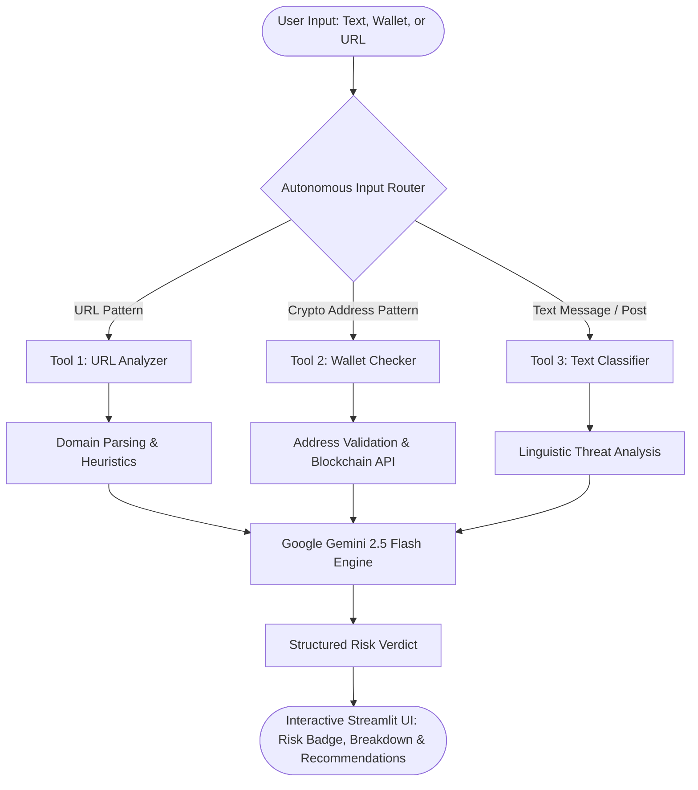

<div align="center">

# 🛡️ Crypto-Sentinel
### *Autonomous Multi-Vector AI Agent for Web3 Fraud & Scam Detection*

[](https://www.python.org/)
[](https://streamlit.io/)
[](https://aistudio.google.com/)
[](https://www.langchain.com/)
[](LICENSE)

<p align="center">
  <b>Intercepting Web3 threats in real-time across phishing messages, deceptive wallet addresses, and malicious domains.</b>
</p>

[Key Features](#-key-features) •
[Agent Architecture](#-agent-architecture) •
[Detection Matrix](#-detection-vectors) •
[Quick Start](#-quick-start) •
[Project Structure](#-project-structure) •
[Author](#-author)

---

</div>

## 📌 Overview

Cryptocurrency scams resulted in **over $5.6 billion in stolen funds in 2023 alone**. Sophisticated social engineering, spoofed decentralized domains, and vanity burner wallets make it challenging for users to distinguish legitimate transactions from scams.

**Crypto-Sentinel** is an intelligent security copilot powered by **Google Gemini** and **LangChain ReAct agents**. It autonomously identifies the type of input, applies domain-specific heuristic security checks, queries live blockchain data, and executes deep reasoning to output an instant risk score with actionable guidance.

---

## ⚡ Key Features

| Capability | Description |
| :--- | :--- |
| **Message Threat Detection** | Analyzes social engineering patterns, fake giveaways, FOMO tactics, and impersonation attempts using Gemini LLM reasoning. |
| **Multi-Chain Wallet Inspection** | Identifies and validates address formats across **Bitcoin**, **Ethereum/EVM**, **Solana**, and **TRON**, cross-referencing on-chain balances and scam patterns. |
| **Domain & Phishing Guard** | Inspects URLs for deceptive typography, suspicious subdomains, newly registered domains, and counterfeit exchange lookalikes. |
| **Autonomous Content Routing** | Zero manual mode switching — the agent automatically detects whether an input is text, a wallet, or a URL. |
| **4-Tier Risk Assessment** | Calibrated ratings (`CRITICAL`, `HIGH`, `MEDIUM`, `LOW`) accompanied by specific flags and preventive safety advice. |
| **Interactive SOC Dashboard** | Built-in analytics dashboard, real-time threat metrics, and persistent session inspection history. |

---

## 🧠 Agent Architecture



---

## 🔍 Detection Vectors

```
┌────────────────────────────────────────────────────────────────────────┐
│                        CRYPTO-SENTINEL AGENT                           │
├────────────────────┬────────────────────┬──────────────────────────────┤
│ 💬 Text Analysis   │ 👛 Wallet Checker  │ 🔗 URL Analyzer              │
├────────────────────┼────────────────────┼──────────────────────────────┤
│ • Fake Giveaways   │ • Bitcoin (BTC)    │ • Typosquatting              │
│ • Urgent FOMO / CTAs│ • Ethereum (EVM)   │ • Punycode Phishing          │
│ • Celebrity Clones │ • Solana (SOL)     │ • Spoofed Exchange Portals   │
│ • Seed Phrase Scams│ • TRON (TRX)       │ • Keyword-injected Subdomains│
│ • Ponzi Promises   │ • Etherscan API    │ • SSL/Domain Pattern Audits  │
└────────────────────┴────────────────────┴──────────────────────────────┘
```

---

## 🖥️ Application Interface

The dashboard includes 4 dedicated pages:
1. **🔍 Threat Detector**: Live single-input scanner with instant risk gauges, evidence chips, and actionable defense recommendations.
2. **📊 Analytics Dashboard**: Real-time summary of total scans, scam percentage, and tool distribution.
3. **📜 Scan History**: Chronological log of analyzed inputs with status badges for auditability.
4. **ℹ️ Threat Intelligence Hub**: Technical breakdown of the ReAct pipeline and detection criteria.

---

## 🚀 Quick Start

### 1. Clone the Repository
```bash
git clone https://github.com/MittalShreya16/Crypto-Sentinel.git
cd Crypto-Sentinel
```

### 2. Set Up a Virtual Environment *(Recommended)*
```bash
# Windows
python -m venv venv
.\venv\Scripts\activate

# macOS / Linux
python3 -m venv venv
source venv/bin/activate
```

### 3. Install Dependencies
```bash
pip install -r requirements.txt
```

### 4. Configure Your API Key
1. Obtain a free Gemini API key from [Google AI Studio](https://aistudio.google.com/).
2. Copy the sample environment file:
   ```bash
   cp .env.example .env
   ```
3. Open `.env` and set your key:
   ```env
   GEMINI_API_KEY=your_gemini_api_key_here
   ```

### 5. Launch Crypto-Sentinel
```bash
streamlit run app.py
```
The application will launch automatically at `http://localhost:8501`.

---

## 📁 Project Structure

```
Crypto-Sentinel/
├── app.py                 # Streamlit UI, Glassmorphism Styling & State Management
├── agent.py               # ReAct Orchestrator & Input Routing Engine
├── text_classifier.py     # Tool 1: Natural Language Scam Pattern Classifier
├── wallet_checker.py      # Tool 2: Blockchain Address & API Validator
├── url_analyzer.py        # Tool 3: Phishing URL & Domain Heuristic Analyzer
├── requirements.txt       # Project Dependencies
├── .env.example           # Environment Configuration Template
├── .gitignore             # Git Ignore Configuration
└── README.md              # Project Documentation & Architecture Guide
```

---

## 🛡️ Security & Disclaimer

> [!WARNING]
> **Educational & Advisory Purpose Only**: Crypto-Sentinel is an AI-assisted detection tool designed to provide risk assessments based on heuristic patterns and LLM analysis. Always perform due diligence before interacting with unfamiliar smart contracts, wallet addresses, or crypto investment offers.

---

## 👩‍💻 Author

<div align="center">

**Shreya Mittal**

[](https://github.com/MittalShreya16)
[](https://www.linkedin.com/in/shreya-mittal-111580221/)

</div>
